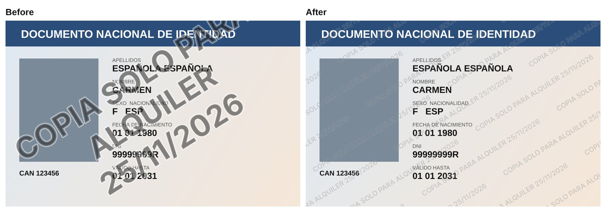

# DNI Tapado.es

Hide the sensitive data on a photo of your Spanish identity document (DNI or TIE) before you share a
copy. Document processing runs in your browser, on your device. The app does not upload your
document.

**Use it:** <https://dnitapado.es>

> [!NOTE]
> **Names and addresses.** The product was called *dnilimpio.es* and is now **DNI Tapado.es** (short
> mark **DT.es**). The site is served from **<https://dnitapado.es>** by Cloudflare Workers, with
> HTTP security headers ([ADR 0027](docs/adr/0027-security-headers-from-the-host.md)). The earlier
> address <https://aasanchez.github.io/dnilimpio.es/> redirects there.
> The GitHub repository keeps the
> name `aasanchez/dnilimpio.es` for now, so every link to the source, the CI and the provenance
> check below uses that name.

> [!IMPORTANT]
> Automatic detection can miss data. Always check every side of the result before you share it.

## Contents

- [What it does](#what-it-does)
- [Supported documents](#supported-documents)
- [How to use it](#how-to-use-it)
- [Privacy and security](#privacy-and-security)
- [Audit it yourself](#audit-it-yourself)
- [Languages](#languages)
- [Status](#status)
- [Development](#development)
- [Tests](#tests)
- [Continuous integration](#continuous-integration)
- [Deployment](#deployment)
- [Project layout](#project-layout)
- [Design decisions](#design-decisions)
- [Contributing](#contributing)
- [Licence](#licence)

## What it does

When a landlord, employer or company asks for a copy of your DNI or TIE, they usually need only
some of the data. This tool makes a copy that shows only what you choose:

1. **Select** a photo of the front and, if you need it, of the back. The back is optional. On a phone, the **capture coach** gives live
   tips and takes the photo by itself when the card is sharp. On a computer, drag and drop, choose a
   file or paste.
2. **Confirm the document**: DNI or TIE. The app reads the card on your device and preselects it,
   including the DNI version (3.0 or 4.0), so you never need to know it.
3. **Straighten**: the app finds the card in each photo, turns it the right way up (sideways or
   upside down) and straightens it. You can place the corners by hand if needed.
4. **Choose the fields to hide** (signature, dates, support number, CAN, MRZ and others). Move or
   resize a cover box by hand if it sits a little off its field, let **Find automatically** cover
   data it reads with on-device OCR, and draw extra black boxes over anything else.
5. **Add a watermark** (optional), for example `FOR RENTAL ONLY`. The text is repeated in small,
   diagonal rows over the whole card, so every part of the image carries it. Text size and opacity
   are adjustable; at 100 % opacity the text is solid black.
6. **Convert to black and white** (optional).
7. **Review** the result and **download a PDF**: one A4 page, named after the document type
   (`redacted-dni.pdf` or `redacted-tie.pdf`). Each side is printed at 130% of the real card size
   (about 111 × 70 mm); with both sides, the front is on top and the back below.
8. **Download or share it**: **Share** opens your device's share sheet with the PDF, where you pick
   WhatsApp, Telegram, Gmail, Mail or another app. The app never sends anything.



The PDF holds new images in which the hidden pixels are replaced with solid black. It is not the
original photo with boxes on top: the hidden data is gone from the file.

The tool does not make an official document, and a redacted copy does not replace the original.
Whether a recipient accepts a redacted copy is up to them.

## Supported documents

| Document | Shape | Source of the field positions | Hidden by default | Optional |
|---|---|---|---|---|
| DNI 4.0 (August 2021 onwards) | card, 85.6 × 54 mm | Policía Nacional specimen | CAN, signature, issue and expiry dates, support number (3 places), MRZ | date and place of birth, address, parents |
| DNI 3.0 (2015 to 2021) | card, 85.6 × 54 mm | PRADO ESP-BO-05001 | CAN, signature, issue date (laser text by the small photo), expiry date, support number (3 places), MRZ | date and place of birth, address, parents |
| TIE, foreigner identity card (2020 model) | card, 85.6 × 54 mm | PRADO ESP-HO-03001 | CAN, signature, issue and expiry dates, card number (2 places), MRZ | date and place of birth, address, permit type |

Positions were measured on official specimens ([method and findings](docs/ZONES.md)); the data is in
[`src/zones/`](src/zones/). The name, the photo and the DNI or NIE number stay visible by design;
cover them with a black box, or with **Find automatically**, if needed. Any other document can be
redacted by hand with black boxes.

**Document detection.** The document is detected from the machine-readable lines (MRZ) on the back,
and you always confirm it ([ADR 0011](docs/adr/0011-document-detection.md)):

- Code `IR` → TIE. Code `ID` → DNI.
- The picker has one **DNI** choice; each version keeps its own layout inside the app
  ([ADR 0021](docs/adr/0021-one-dni-choice.md)). Both versions have the same MRZ, so the version
  comes from the issue date. It is worked out from the dates of birth and expiry (a DNI is valid
  2 years under age 5, 5 years under 30 and 10 years under 70; the DNI 4.0 is issued from
  2 August 2021).
- When the version cannot be detected (dates that fit both and an unreadable front, a permanent DNI
  for a holder 70 or over, or no OCR), the app uses the DNI 4.0, the most common one, and says so.
  The editor has an **Older DNI (3.0)** switch next to the box controls: it changes the layout and
  keeps your photos and choices.
- While the photos are read, nothing is selected and **Continue** waits. When detection reads the
  photos but cannot tell the document, the app selects **TIE** and says so: DNI detection is
  reliable, so an unrecognised card is most likely a TIE. You can change it
  ([ADR 0028](docs/adr/0028-tie-fallback.md)). When detection cannot run (offline before the first
  download, an old browser), nothing is selected and **Continue** waits for your choice.
- When the MRZ cannot settle it (no MRZ read, or dates that fit both DNI versions), the app also reads
  the printed text of the front, such as "PERMISO DE RESIDENCIA" or "REINO DE ESPAÑA", and where the
  DNI number sits ([ADR 0019](docs/adr/0019-ppocr-and-text-detection.md)). The MRZ wins when both answer.
- Detection needs OCR. Online, the first time, it downloads the OCR files by itself (about 9 MB; the
  status line says so). After that it also runs offline. When OCR cannot run (offline before the
  first download, no service worker or one that does not answer, an old browser), a note says so
  and you choose by hand. A choice you make yourself is never changed.

**Card guide.** "What is on my card?" on the start screen, and the ⓘ beside each field in the
editor, open a guide to every element of each card (one DNI tab with a 4.0/3.0 switch, and the TIE): what it is, how a copy of it can be misused, and
what the app does with it. Every statement cites the official text that says it (BOE, EUR-Lex, ICAO
Doc 9303, Policía Nacional, PRADO, AEPD, INCIBE), with links that open in a new tab. When no official
source was found, the guide says so instead of guessing ([ADR 0014](docs/adr/0014-card-guide.md),
[source notes](docs/GUIDE-SOURCES.md)). The guide is bundled with the app, so it also opens offline.

## How to use it

Open the site in a current browser (Chrome, Edge, Firefox, Safari; desktop or mobile). No account,
no installation needed. If you want it on your home screen or desktop, you can install it as an app
(see **Install the app** below). The layout is built for a phone first: one step per screen, the main button always
at the bottom within thumb reach, and a progress bar at the top (**Photos**, **Corners**, **Hide**,
**Download**). The back arrow in the top bar returns to the previous step without losing work. The
**DT.es** logo returns to the start screen without reloading the page; your photos are kept.

1. **Start screen.** It explains what the tool does and has:
   - **What is on my card?**, the [card guide](#supported-documents).
   - The **no-cookies notice**, in the place where other sites put a cookie banner. It only informs:
     there is nothing to accept. English text: *"No cookies, no profiles, no data to sell. Your
     document is processed on your device, and the app does not upload it. Every Eurocrat's dream:
     this banner only exists to tell you it isn't needed."* It stays short on purpose; this README lists
     exactly what is sent and stored ([Privacy and security](#privacy-and-security)). **I believe you** closes it; it comes back after 4 days at
     the earliest.
   - In the footer: **Source code** (this repository, in a new tab), **Check it with your AI** (see
     [Audit it yourself](#audit-it-yourself)), the build version and deploy time, and the NagWara
     product band.

   Optional: disconnect from the Internet once the page has loaded. After the first visit, the tool
   also opens with no connection. Press **Start**.
2. **Photos.** Take or choose a photo of the front. The app then moves to the back by itself.
   The back is optional: many requests need only the front. **Continue without the back** goes on
   with the front alone, and the rest of the flow works on that one side: the editor shows only the
   front's fields, and the PDF shows only the front, centred on the page. **Remove the photo of the back** drops a back you added
   by mistake. In the capture coach, **Continue without the back** closes the camera after the front.
   - On a phone, **Take a photo** opens the capture coach (see below) and **Gallery** opens your
     pictures.
   - On a computer, the photo area is an upload area: drag an image onto it, use **Choose a file**,
     or paste with <kbd>Ctrl</kbd>+<kbd>V</kbd>. A file dropped anywhere else in the window is
     ignored, so it never replaces the app in the tab.
   - JPEG, PNG, WebP and HEIC photos are accepted, up to 25 MB and 50 megapixels. The app checks
     the file's first bytes, not its name, and reads the size in pixels from the file's header
     before it decodes the image ([ADR 0031](docs/adr/0031-photo-file-checks.md)). Only Safari 17
     and later can open HEIC; other browsers say so and suggest a screenshot or a JPEG copy. On an
     iPhone the photo picker usually gives the app a JPEG anyway. Tap a side's tile to replace its
     photo.

   **Capture coach.** A live camera view with a card-shaped frame. Inside the frame, a faint
   drawing shows which side to hold up: a photo and text lines for the front, text lines and the
   three machine-readable lines for the back. It fades once the card is in place. Below it, one tip
   at a time: *Fit the card inside the frame*, *Move a little closer*, *Hold the card straight*,
   *Too dark*, *Glare: tilt the card slightly*, *Hold the phone still*, *Blurry: wait for it to
   focus*. When every check passes for about half a second, the photo is taken by itself, and the
   view moves to the back: turn the card over and it takes that one too. The round button takes the
   photo at any moment, **Automatic shot** turns the automatic photo off, and ✕ closes the camera.

   The coach uses no model and no network, so it works the same online and offline
   ([ADR 0008](docs/adr/0008-capture-coach.md)). It needs a browser that gives web pages a live
   camera, and your permission. If either is missing (permission refused, no camera, an old browser,
   the page opened from a file), the coach does not open: a short note appears, and **Take a photo**
   opens the phone's own camera app instead.
3. **Document.** Confirm DNI or TIE, then **Continue**. The app reads the card on your device and
   preselects the document: *Document detected: TIE. Check it before you continue.* For a DNI it
   also picks the version (3.0 or 4.0), whose field positions differ; when it cannot tell, it uses
   the 4.0 and the editor offers an **Older DNI (3.0)** switch. You can choose by hand at any moment. While the photos are
   read, **Continue** stays off. When the app reads the card but cannot tell the
   document, it selects TIE: *TIE is selected. If it is a DNI, change it.* When it cannot read the
   card (no OCR), nothing is selected. To change the document later, go back from the editor: your
   photos are kept, the corners and choices start again.
4. **Straighten (automatic).** After **Continue**, the app looks for the card in each photo (with the
   on-device model, or classic edge detection), turns it the right way up, whether the photo was
   taken sideways or upside down, and straightens it. It then opens step 5 with both sides already
   corrected. You only see the corner screen when:
   - the card was not found in a photo (*We could not find the document in this photo. Place the
     corners by hand.*),
   - you tap **Place the corners myself** while it works, or
   - you tap **Adjust corners** in step 5.

   **Corner screen.** The four circles sit on the corners that were found. Drag them onto the
   corners of the card; a magnifier shows the area under your finger. On a keyboard, arrow keys move
   the selected corner and <kbd>N</kbd> selects the next one. **Rotate** turns the frame a quarter
   turn, **Reset** puts the circles back. The button straightens the card again and takes you on.
   Switching to the other side with the **Front** and **Back** tabs saves the corners you moved,
   with no button to press. Crossed corners stay on screen, but that side is not done yet.
5. **Hide.** The card stays on screen. Choose **Front** or **Back** (only with a back photo); the
   list below shows that side's fields as switches. You can also tap a field on the card itself to cover or uncover it.
   The recommended fields start covered (see [Supported documents](#supported-documents)). Fields
   left visible get a dashed orange outline; **Final preview** hides the outlines. A warning appears
   if the CAN stays visible, or if the MRZ stays visible while data it repeats is hidden.
   **Adjust corners** goes back to step 4 and keeps your choices. Three tabs:
   - **Data:** the field switches and quick choices (**Recommended**, **Hide all**, **Show all**).
     - **Adjust boxes** lets you move or resize each cover box by hand when the template sits a
       little off the card. While you adjust, you see the photo uncovered; the copy stays covered.
       With a keyboard, <kbd>N</kbd> selects the next box, arrow keys move it and
       <kbd>Shift</kbd>+arrows resize it. **Back to original position** undoes the adjustments.
     - **Fit to the text** reads both sides with OCR on your device and makes the boxes of the
       fields you hide bigger where the printed text runs past them. A box never gets smaller, never
       grows over a field you leave visible, and **Back to original position** undoes it. Only the
       positions of the words are used; the text read is not kept.
     - **Find automatically** reads both sides with OCR on your device and adds a black box over each
       piece of data you pick: name and surnames, DNI/NIE number, dates, support number, CAN and MRZ
       lines. Dates, support number, CAN and MRZ are picked to start with; name and number are not.
       It works from the text itself, so it also finds data on layouts the app has not measured. A
       DNI/NIE number or a date counts only when its check letter or calendar date is valid. The
       boxes it adds are ordinary boxes: check them in **Boxes**, move or delete them, or undo them
       all in one step ([ADR 0010](docs/adr/0010-smart-field-finding.md)). The first use downloads
       about 9 MB. If finding cannot run (offline before that download, or a browser without a
       service worker), the button is disabled with a short note and you hide the data by hand.
   - **Boxes:** extra black boxes for anything the list does not cover. Turn on **Draw black box**
     and drag on the card. Select a box to move it, or drag its corners to resize it. **Undo** and
     **Redo** (<kbd>Ctrl</kbd>+<kbd>Z</kbd>, <kbd>Ctrl</kbd>+<kbd>Shift</kbd>+<kbd>Z</kbd>) work on
     boxes. With a keyboard: **Add box**, then arrow keys move it, <kbd>Shift</kbd>+arrows resize it,
     <kbd>N</kbd> selects the next box and <kbd>Delete</kbd> removes it.
   - **Watermark:** type what the copy is for, or pick a suggestion (rental, bank, dated copy). The
     card updates as you type. Long text wraps onto a few short lines (at most 120 characters).
     **Text size** (50 % to 300 %) and **Opacity** (5 % to 100 %, default 16 %) apply live; at 100 %
     the text is solid black. **Convert to black and white** is here too.
6. **Download or share.** Check the final images (one per side) and the summary, tick **I have
   checked both sides** (or **I have checked the front**), then press **Share** or **Download PDF**.
   **Share** appears only where the browser can share files (most phones, Safari on macOS, Chrome on
   Windows and ChromeOS). It opens the system share sheet with the PDF (`redacted-dni.pdf` or
   `redacted-tie.pdf`): you pick WhatsApp, Telegram, Gmail, Mail or another app, and the person. A shared PDF is not saved to your
   downloads folder. **Download PDF** saves the same file. You stay on the review, so you
   can download or share again. **Start again** or closing the tab clears everything.
7. **Optional: send anonymous data.** Once the PDF is downloaded or shared, a small **Send anonymous
   data** link appears below the buttons. It clears the photos and opens a separate page that holds
   no document. That page shows, line by line, the exact anonymous figures it could send: document
   type, whether the AI got it right, which fields you covered, and your device type. Nothing is
   sent unless you tap **Send anonymous stats**; the button then says **Thank you!**. **Start
   again** returns to the start screen. See [Usage stats (opt-in)](#usage-stats-opt-in).

## Privacy and security

**In short.** Document processing runs on your device: detection, text recognition (OCR),
redaction, the watermark and the PDF all run in your browser. The app does not upload your
document. The site sends no photo, file name or data read from the card to any server. It uses no
cookies, trackers or profiles, and no third-party script runs in the page that holds your photos.
The site has no analytics code: the host counts the requests it serves (see
[Visit counts](#visit-counts)). After you clear everything, a separate page that holds no document
can send anonymous usage stats, only if you tap Send (see [Usage stats (opt-in)](#usage-stats-opt-in)). The page downloads only its own files; once they
are on your device you can go offline. Your browser keeps those files and one date (see **No
storage of your data** below). The PDF leaves the
app only when you download or share it. An external security and privacy audit (25 November 2026)
reviewed this; its findings are fixed and covered by tests (see [Security reviews](#security-reviews)).

### What the tool guarantees

- **No upload.** Photos are processed in the browser with the Canvas API. The site is static. Its one
  piece of server code receives the opt-in usage stats only, and accepts nothing else
  ([`worker/index.ts`](worker/index.ts)).
- **No network access from the app page.** The Content Security Policy
  ([`scripts/csp.ts`](scripts/csp.ts)) is `default-src 'none'` and `connect-src 'none'`: page code
  cannot send a request to any address. There is no `'self'`: page code cannot send a request to the site's own origin either, even before
  the service worker is in place ([ADR 0022](docs/adr/0022-no-published-source-maps.md)). The app
  itself never calls `fetch()`.
  It loads scripts, styles, fonts and images only from its own origin, and it can open no frame at
  all. `form-action`, `base-uri` and `object-src` are `'none'`. WebRTC, which no
  CSP rule covers, is removed before any code runs. A new frame or pop-up would bring a fresh copy
  of it, so the page also refuses to add any frame element and opens no pop-up; a frame that
  appeared anyway would get the same lockdown and be removed
  ([ADR 0034](docs/adr/0034-no-frames-no-fresh-webrtc.md)). The CSP `webrtc 'block'` directive
  would do this in the policy itself, but no browser implements it yet.
- **Deny by default.** After the first visit, the service worker answers only the exact files of this
  build. Any other request from the page or its workers (another address, a query string, another
  method) is refused and never reaches the network, so even a same-origin request cannot carry data
  out ([ADR 0004](docs/adr/0004-offline-service-worker.md)). The one exception is the opt-in stats
  POST, and only from the thanks page ([ADR 0029](docs/adr/0029-opt-in-usage-stats.md)). An end-to-end test runs a whole document workflow with
  fictional card values and checks that no request is sent and none carries those values
  ([`tests/e2e/privacy.spec.ts`](tests/e2e/privacy.spec.ts)).
- **Tighter rules while photos are in the page.** Before the photo step opens, the app loads every
  font it needs and adds a second, stricter CSP. From then on the page can load only this build's
  scripts and workers, each by its exact address, and images only from memory (`blob:`, `data:`).
  No font, stylesheet, manifest or frame, and no connection at all.
  The policy stays until the page is reloaded, and a reload drops the photos. The photo step says
  when the service worker's filter is not active on this visit; the app then works the same
  ([ADR 0025](docs/adr/0025-intake-lockdown.md)).
- **On-device AI only.** The corner finder is a small model (DocCornerNet from `scanic-ml`) that runs
  in the page with WebAssembly. The photo goes to it in memory, scaled to 224 × 224 pixels, and
  nowhere else. The CSP allows WebAssembly (`'wasm-unsafe-eval'`) but still no `eval()`
  ([ADR 0007](docs/adr/0007-corner-model.md)).
- **No storage of your data.** Photos, fields, watermark text and PDFs are kept in memory only. The
  code is not allowed to use browser storage, cookies or network APIs (`localStorage`,
  `sessionStorage`, `indexedDB`, `document.cookie`, `fetch`, `sendBeacon` and others, enforced by the
  linter). The site does store two things in your browser, and neither holds data from your
  document:
  - **The app's own files, in Cache Storage** (caches named `dnilimpio-…`), written by the service
    worker for offline use: the HTML, scripts, styles, fonts and icons on the first visit, and the
    AI files the first time you use them (the corner model in `assets/ml/`, about 2.6 MB, and the
    OCR engine in `ocr/`, about 9 MB). They are the same bytes for every visitor, checked by hash.
    The browser's ordinary HTTP cache can also keep copies of these files.
  - **One `localStorage` key**, `dnilimpio.noticeDismissedAt`, with the date and time you last
    closed the no-cookies notice, so it shows at most every 4 days
    ([`src/ui/notice-memory.ts`](src/ui/notice-memory.ts), the only file allowed to use storage). If
    the browser blocks storage, the notice simply shows on every visit.

  To remove them, clear the site's data in the browser settings. A test
  checks that cookies and storage hold nothing else after a whole workflow.
- **Clearing means everything.** **Start again** and **Send anonymous data** drop the photos and
  every choice, stop the OCR worker, which keeps the last image it read, and revoke the PDF's
  download link if it is still open. Leaving the page (another site, closing the tab, a reload) does the same, so the
  browser's back-forward cache keeps no document. Links that leave the app (source code, card guide
  sources, NagWara) open in a new tab for that reason.
- **Memory is cleared as far as a page can.** Each screen shrinks its canvases to 0 × 0 pixels when
  it closes. Temporary copies of the photo (scaled copies, grey copies for the upside-down check and
  edge detection, the model's input, camera frames) are overwritten with zeros right after use, also
  when a step fails. The PDF kept for sharing is dropped when you leave the review, and its download
  link is revoked after 10 seconds or at once when the app clears. Work still running for old
  photos (straightening, corner finding, OCR, the PDF) checks that its screen is still open, so a
  late result never brings a cleared document back ([`src/engine/wipe.ts`](src/engine/wipe.ts),
  [`tests/e2e/cleanup.spec.ts`](tests/e2e/cleanup.spec.ts)).
- **Text recognition (OCR) on the device.** When OCR is used, the image is read by a Web Worker in
  your browser. The OCR engine (PP-OCRv6 tiny on ONNX Runtime, about 9 MB) comes from this site,
  never from a third party. Its files are downloaded only the first time OCR is used and are checked
  against their hash before use. The worker runs under its own strict CSP: it can read its own files in `ocr/` and
  cannot send requests anywhere. If OCR cannot run (offline before the first download, or no service
  worker, or one that does not answer in time), it is switched off and you choose by hand ([ADR 0009](docs/adr/0009-on-device-ocr.md),
  [ADR 0019](docs/adr/0019-ppocr-and-text-detection.md)).
- **Works offline.** After one visit, a service worker keeps a copy of the app's files, and the tool
  works with no network. Each file is checked against the SHA-384 hash recorded at build time before
  it is stored; if one does not match, nothing is stored ([ADR 0004](docs/adr/0004-offline-service-worker.md)).
  Each file is checked again every time the worker serves it from the cache; a copy that was changed
  is deleted and downloaded again, or refused offline ([ADR 0026](docs/adr/0026-recheck-cache-hits.md)).
  The corner model (about 2.6 MB) is not part of that first copy: it is stored the first time you use
  it online. Offline before that, classic edge detection places the corners, or you place them by
  hand.
- **Installable.** The tool can be installed as an app (Android, iPhone and iPad, desktop Chrome and
  Edge). It is the same build in its own window: the manifest and icons are static files of the
  build, cached and checked like the rest, and installing sends nothing anywhere. The start screen
  shows **Install the app** only where it works: it opens the browser's own dialog, or, on iPhone and
  iPad, shows the steps in the Share menu ([ADR 0018](docs/adr/0018-installable-app.md)).
- **Updates never interrupt work.** A new version reaches an open tab by itself: when every open
  window of the tool is on the start screen with no photos, they switch to the new version and reload
  once. A tab with photos keeps its version until it returns to the start screen. When another window
  cannot answer (a tab or the installed app frozen in the background), the start screen shows
  **Update now** instead ([`src/offline/update.ts`](src/offline/update.ts),
  [ADR 0030](docs/adr/0030-update-with-other-windows-open.md)).
- **Camera stays on the device.** The live camera (capture coach) is analysed frame by frame in
  memory. No frame is stored or sent, and the camera turns off when you close the view, finish both
  sides or leave the tab.
- **No tracking and no third-party scripts beside your photos.** No cookies, profiles, telemetry or
  external fonts. Only this site's own scripts run in the page that holds the photos
  ([ADR 0023](docs/adr/0023-no-third-party-script-with-photos.md)); a test fails if any other script
  runs there. The host counts the requests it serves (see [Visit counts](#visit-counts)). Fonts and icons are self-hosted or inline.
- **Security headers from the host.** dnitapado.es sends the full CSP as a header, with
  `frame-ancestors 'none'`, plus HSTS, `X-Content-Type-Options: nosniff`,
  `Referrer-Policy: no-referrer`, a `Permissions-Policy` that allows only the camera, clipboard
  writing and sharing, `Cross-Origin-Opener-Policy` and `Cross-Origin-Resource-Policy`. The service
  worker and the OCR worker get their own CSP. The headers are generated from
  [`scripts/csp.ts`](scripts/csp.ts) by [`scripts/headers.ts`](scripts/headers.ts)
  ([ADR 0027](docs/adr/0027-security-headers-from-the-host.md)). The `<meta>` CSP stays as a fallback.
- **No framing.** The host refuses to show the app inside another site's frame. On a host that
  sends no headers (a fork, a local copy), the app does not start in a frame; it only offers to open
  itself in its own tab. Page loads answered by the service worker add `frame-ancestors 'none'`,
  `X-Frame-Options: DENY`, `X-Content-Type-Options: nosniff` and `Referrer-Policy: no-referrer` on
  any host.
- **One Trusted Types policy.** The page never turns strings into HTML (no `innerHTML`, no
  `{@html}`). Trusted Types are required, and the only policy, `default`, accepts two script URLs:
  the service worker and the OCR worker.
- **Real redaction.** Hidden areas are painted as opaque black pixels on a new image, with a margin
  around each field. The watermark is not drawn over them: the app paints them black again after the
  watermark and checks every one of their pixels before export. Blur and pixelation are not offered,
  because they can be reversed.
- **Clean PDF.** Each image is re-encoded, and the JPEG is rebuilt with only the data a decoder needs:
  no EXIF, GPS, camera model, thumbnail or comments. The PDF has no metadata, no text, no
  annotations, no scripts and no attachments. Tests check this object by object.
- **Verifiable code.** The production build is minified and publishes no source maps
  ([ADR 0022](docs/adr/0022-no-published-source-maps.md)); you check it by rebuilding the same commit
  and comparing hashes. Every script and stylesheet has a
  Subresource Integrity hash, including the PDF code that loads in the background after the page
  appears (its hash is in an import map, allowed by the CSP through its own SHA-256 hash). A changed
  file is refused by the browser, both when the page loads it and when it is saved for offline use.
  The build is reproducible, and CI rebuilds the release commit itself before it deploys. Every
  deployed file has signed build provenance, which CI then checks with a pinned identity, and the
  SHA-384 of every file of each release is kept as signed evidence. After each deploy CI checks that
  the live site serves exactly the files it built. See
  [Audit it yourself](#audit-it-yourself).

### What it cannot guarantee

- **Automatic detection can miss data.** Always check both sides before you download.
- **The browser, extensions and operating system are outside the tool's control.** A malicious
  extension or a compromised device can read what the page shows. Swap files, crash reports and GPU
  memory are managed by the system.
- **The host sees that you visited.** Like any website, the host (Cloudflare) receives your IP address,
  browser, time and which of the app's files were downloaded (for example, that the OCR files were
  fetched the first time you used OCR). It never receives your photos or data.
- **The first visit and a forced reload are not covered by the service worker.** The CSP still
  applies; the deny-by-default rule starts once the service worker controls the page. In that window
  the CSP still allows images, scripts, styles and fonts from the site's own origin (`img-src`,
  `script-src`, `style-src`, `font-src`). On dnitapado.es the OCR worker has the host's CSP (its
  own origin only); on a host that sends no headers it runs without its own CSP. `connect-src` has no
  `'self'`, so page code cannot send a `fetch()`, a request body or custom headers there. The host
  would see the address of an image or script request. Only this build's verified code runs, and it
  never makes one. Once photos are in the
  page, the stricter policy closes images, styles and fonts too; a script import of one of the
  build's own files with a query string is the one load CSP alone cannot stop, because CSP ignores
  query strings ([ADR 0025](docs/adr/0025-intake-lockdown.md)).
- **The service worker does not protect against code already in the page.** Code running with the
  page's privileges could unregister the worker, delete its caches or navigate away. The worker
  stops a missing or foreign worker setup from going unnoticed, not a compromised page.
- **No browser rule can stop a page from navigating to a URL.** The protection there is that only
  this build's verified code runs (CSP, SRI, the locked dependency list) and that the code never
  navigates with your data (enforced by the linter).
- **Sharing is your choice.** **Share** hands the PDF to the app you pick through the system share
  sheet (Web Share API, on the device), with a title and no text or link. What that app does with it
  is outside the tool. The page itself still sends nothing (`connect-src 'none'`). The PDF is built
  when you tick the check box, so the share sheet opens within your tap; it stays in memory only
  until you leave the review.
- **Memory is released, not securely erased.** JavaScript cannot erase memory securely. Zeroing a
  buffer overwrites that buffer only; the browser, the graphics driver and the operating system may
  keep other copies (the decoded photo, GPU textures, the file you chose, swap or a crash report).
  Shrinking a canvas lets the browser free its pixels sooner, but does not overwrite them. Text read
  by OCR lives in JavaScript strings, which cannot be overwritten at all. These steps shorten how long
  your data stays in memory; they do not guarantee it is gone. To be sure, close the browser after
  use.
- **Cache Storage is not private storage.** The cached app files hold nothing from your document,
  but anyone with access to your browser profile can see that the site was used, and that its AI
  files were downloaded.
- **A watermark discourages reuse but cannot prevent identity fraud.**
- **Greyscale is not a security measure.**

### Visit counts

The site has no analytics code: no script, no frame, no tracking pixel and no cookie
([ADR 0027](docs/adr/0027-security-headers-from-the-host.md)).

- **Where the counts come from.** The host counts the requests it serves, as every web server does.
  Its dashboard shows totals: requests, unique visitors (by IP address) and countries.
- **What the host gets.** What every request carries: your IP address, your browser, the time and
  the file requested. The app adds nothing to it, because the page cannot send a request of its own.
- **What the counts miss.** They include bots. They undercount returning visitors, whose files come
  from the service worker's copy on the device. They say nothing about what anyone does in the app.
- **Tests.** [`tests/e2e/third-party.spec.ts`](tests/e2e/third-party.spec.ts) checks that no script
  from another site runs, that the page opens no frame and that nothing leaves for another site,
  from the start screen to a loaded card. The post-deploy check fails if the live site sets a cookie.

### Usage stats (opt-in)

The app can send anonymous usage figures, only when you ask, and only after your document is gone
([ADR 0029](docs/adr/0029-opt-in-usage-stats.md)).

- **When.** **Send anonymous data**, a small link on the review screen once the PDF has left, clears the photos and your choices, then opens
  `thanks.html`. That is a separate page: it never holds a photo and loads none of the image, AI or
  PDF code. It shows the exact text it would send. It sends it once, only when you tap **Send
  anonymous stats**. Offline, the button is off.
- **What.** A fixed list ([`src/stats/schema.ts`](src/stats/schema.ts)): the document model; whether
  detection got it right (`right`, `wrong`, `none`, `off`); whether you added the back; the ids of
  the fields you covered (for example `can`, `mrz`, `signature`); how many extra boxes you drew;
  whether you added a watermark and used greyscale (never the watermark's text); the language; the
  build; where the photos came from (`camera`, `file`, `paste`); whether OCR ran; and the device type,
  system family, browser family and major version, and whether the app is installed.
- **What not.** No text, image, position or file name from your document. Not the browser's full
  identifier, screen size, time zone or hardware details: together they could single out a device.
  No cookie and no ID.
- **How it travels.** The app hands the figures to the thanks page after `#` in its address. Browsers
  never send that part to a server. The thanks page checks it against the fixed list, removes it
  from the address and drops anything else.
- **Where it goes.** One `POST` to `/stats` on dnitapado.es. A small Cloudflare Worker
  ([`worker/index.ts`](worker/index.ts), checks in [`src/stats/endpoint.ts`](src/stats/endpoint.ts)) accepts only the exact list and writes one row to Workers
  Analytics Engine, with the country that Cloudflare reads from the request. It does not store the
  IP address, sets no cookie and keeps no request log. Cloudflare still sees the IP address and
  browser of every request at its edge, as for any page load.
- **What stays locked.** The app page keeps `connect-src 'none'` and `form-action 'none'`, also
  from the photo step on. Only `thanks.html` has its own policy, with `connect-src 'self'`
  (`THANKS_CSP` in [`scripts/csp.ts`](scripts/csp.ts)). The service worker passes on the stats `POST`
  only when the thanks page sends it.
- **Limits.** Anyone can post a valid row, so the numbers are indications, not proof. The
  `Sec-Fetch-Site` check stops other sites' pages only, not scripts. A rate limit
  (`ratelimits` in [`wrangler.jsonc`](wrangler.jsonc)) caps valid rows at 60 per minute per
  Cloudflare location and answers 429 above that. It uses one key for all senders, not the IP
  address, so a flood can also make real sends fail for that minute.
- **Tests.** [`tests/unit/stats.test.ts`](tests/unit/stats.test.ts) checks the list, the device
  classes, the Worker (including a body over 600 bytes, also when it has no Content-Length) and the
  service worker route.
  [`tests/e2e/stats.spec.ts`](tests/e2e/stats.spec.ts) checks that nothing is sent before the tap,
  that the text sent is the text shown, that the app page still cannot connect, and the offline and
  error cases.

Example query (Workers Analytics Engine SQL API): how often each field is covered, per document.

```sql
SELECT blob2 AS doc, SUM(_sample_interval) AS uses,
       SUM(_sample_interval * double9) AS signature, SUM(_sample_interval * double13) AS can,
       SUM(_sample_interval * double14) AS mrz
FROM dnitapado_usage
WHERE timestamp > NOW() - INTERVAL '30' DAY
GROUP BY doc
```

Columns: `blob1` list version, `blob2` document, `blob3` detection result, `blob4` language,
`blob5` build, `blob6` photo source, `blob7` device, `blob8` system, `blob9` browser, `blob10`
country, `blob11` covered fields; `double1` back, `double2` boxes, `double3` watermark, `double4`
greyscale, `double5` OCR ran, `double6` browser version, `double7` installed, `double8` number of
covered fields, `double9` to `double19` one per field in the order of `FIELDS`.

### Security reviews

An external static review of the source (25 November 2026) found no upload or storage of documents
and no high or critical issue. It raised 6 medium and 5 low findings about defence in depth. One,
that the host can see when the OCR files are first downloaded, is a limit of any website and is
described above. The others were fixed in separate pull requests with tests:

- the service worker's deny-by-default rule and the OCR worker's own CSP
  ([#29](https://github.com/aasanchez/dnilimpio.es/pull/29), [#31](https://github.com/aasanchez/dnilimpio.es/pull/31));
- OCR cleanup ([#32](https://github.com/aasanchez/dnilimpio.es/pull/32));
- the end-to-end privacy test ([#33](https://github.com/aasanchez/dnilimpio.es/pull/33));
- the full post-deploy check ([#34](https://github.com/aasanchez/dnilimpio.es/pull/34));
- reproducible builds, SBOM and provenance ([#35](https://github.com/aasanchez/dnilimpio.es/pull/35));
- WebRTC, framing and `pagehide` ([#36](https://github.com/aasanchez/dnilimpio.es/pull/36));
- buffer clearing and wider lint rules ([#38](https://github.com/aasanchez/dnilimpio.es/pull/38)).

A later review (26 November 2026, finding PRIV-003) noted that `connect-src 'self'`, added to load
source maps in the developer tools, let page code send requests to the site's own origin before
the service worker controls the page. The maps are no longer published and `'self'` is gone from
`connect-src` ([ADR 0022](docs/adr/0022-no-published-source-maps.md)).

The same day, an audit showed that the Cloudflare Web Analytics beacon, which ran in the same page as
the photos without an SRI hash, could be replaced by a script that read the unredacted preview and
sent it to Cloudflare's report address. The beacon is removed, `connect-src` is `'none'`, and a test
fails if any third-party script runs in that page
([ADR 0023](docs/adr/0023-no-third-party-script-with-photos.md)). For a short time visits were
counted from an isolated frame on another site
([ADR 0024](docs/adr/0024-visit-counter-in-isolated-frame.md)). That frame is removed too: the site
has no analytics code, and the host counts requests
([ADR 0027](docs/adr/0027-security-headers-from-the-host.md)).

Headers that need a server for every response (HSTS, Permissions-Policy, COOP) cannot be set on
GitHub Pages, so dnitapado.es moved to Cloudflare Workers, which sends them
([ADR 0027](docs/adr/0027-security-headers-from-the-host.md)). COEP is not set: the page loads nothing from another site, so it would protect nothing more, and
the app does not need cross-origin isolation.

Cloudflare added Network Error Logging headers that ask the browser to report failed requests to
Cloudflare. Every file now turns them off, the zone setting is off, and the post-deploy check fails
if they come back ([ADR 0035](docs/adr/0035-no-network-error-logging.md)).

## Audit it yourself

You do not have to trust the claims above. Each one can be checked.

**In the browser**

1. Open the browser's developer tools, **Network** tab, before you select a photo.
2. Use the tool to the end. The only requests are the page's own files, all from the same origin.
   No request goes to another site. After **Send anonymous data**, the stats page sends one `POST` to
   `/stats`, and only if you tap **Send anonymous stats**; its body is the text the page shows. The first time you
   select a photo, the page also downloads the corner model (`assets/ml/`), and the first time OCR
   runs, the OCR files (`ocr/`), both from the same origin. These are plain downloads of the app's
   files and carry nothing from you.
3. For the strongest check, load the page, then disconnect from the Internet (airplane mode) before
   you select a photo. The tool keeps working, including after a reload.
4. Read the policy in the page source: `<meta http-equiv="Content-Security-Policy">`.
5. Check which code you run: the start screen's footer shows the release version, linked to its
   GitHub Release, and the short commit SHA of the build, linked to that commit on GitHub (see [Version shown in the app](#version-shown-in-the-app)).

The site publishes no source maps ([ADR 0022](docs/adr/0022-no-published-source-maps.md)). To check the
running code, rebuild that commit (below) and compare the hashes; the source is `src/` at that
commit. A local build with `build.sourcemap` turned on is for reading only: its file names and
hashes differ from the deployed build.

**With an AI coding agent.** **Check it with your AI** on the start screen (in the footer and in the
no-cookies notice) opens a short audit prompt to copy into an AI coding agent. It lists the privacy
claims and where the evidence is, including the one intended send (the opt-in stats and their fixed
fields), and asks the agent to try to disprove each claim. It does not argue for the claims. The agent
must check the live site at <https://dnitapado.es/> as well as the source: its headers and CSP against
[`scripts/csp.ts`](scripts/csp.ts) and [`scripts/headers.ts`](scripts/headers.ts), the hash of every
file it serves, that no source map is served, and a rebuild of the commit shown in the footer. It asks
for findings with a severity and evidence, not a pass or fail. Copying uses the clipboard
only; nothing is sent. The text is in [`src/security/audit-prompt.ts`](src/security/audit-prompt.ts).

**Check that the live files are the ones built from this repository**

- **Provenance.** Every deployed file has signed build provenance. Check a folder of files (for
  example files saved from the live site, or the `dist` artifact of a CI run) against the commit in
  the footer:

  ```sh
  node scripts/verify-release.ts <folder> <full commit SHA>
  ```

  It runs `gh attestation verify` on each file and accepts only provenance signed for this
  repository, the CI workflow on `master`, that exact commit and a GitHub-hosted runner. For one file:

  ```sh
  gh attestation verify <file> --repo aasanchez/dnilimpio.es \
    --signer-workflow aasanchez/dnilimpio.es/.github/workflows/ci.yml \
    --source-ref refs/heads/master --source-digest <full commit SHA>
  ```

- **Release evidence.** Each release run keeps a `release-evidence` artifact for 90 days: the
  SHA-384 of every deployed file (`files.sha384.txt`), the commit, the version and the SBOM. These
  files are attested too, so their signed provenance stays with GitHub after the artifact expires.
  The same files are attached to the version's
  [GitHub Release](https://github.com/aasanchez/dnilimpio.es/releases), which does not expire.

- **Rebuild.** The build is reproducible: the same commit gives the same bytes.

  ```sh
  git checkout <commit>
  export SOURCE_DATE_EPOCH="$(git log -1 --format=%ct)" GITHUB_SHA="$(git rev-parse HEAD)"
  export RELEASE_VERSION=<version>     # from the footer or the release's version.txt, such as 1.4.8
  pnpm install --frozen-lockfile && pnpm build
  node scripts/build-manifest.ts dist   # SHA-384 of every file, to compare with the live site
  ```

- **Post-deploy check.** After every deploy, CI's `smoke` job
  ([`scripts/smoke.ts`](scripts/smoke.ts)) downloads the live site and checks it byte for byte
  against the build (see [Continuous integration](#continuous-integration)).

Security problems: please report them privately through GitHub's
[security advisories](https://github.com/aasanchez/dnilimpio.es/security/advisories/new), not in a
public issue.

## Languages

The interface is available in 13 languages: Spanish (default), Catalan, Valencian, Galician, Basque,
English, French, Dutch, Swedish, Finnish, Ukrainian, Romanian and Arabic (right to left). Every
language is a file of the build, served from this site and precached by the service worker, so the
selector also works offline. The start page holds only Spanish; the page's own language loads as
one small file before the first render, and a language picked later loads when it is picked. The
app never downloads a translation from anywhere else. The language follows the browser and can be
changed from the selector at the top. The card guide has its own texts per
language ([`src/guide/locales/`](src/guide/locales/)).

Translations other than Spanish and English are machine-assisted drafts. Corrections are welcome:
edit one file in [`src/i18n/locales/`](src/i18n/locales/) and open a pull request. The step-by-step
guide is in [CONTRIBUTING.md](CONTRIBUTING.md#help-with-translations). Spanish
(`es.json`) defines the keys. Translations can also be managed with Crowdin through its GitHub
integration ([`crowdin.yml`](crowdin.yml)); the app itself never contacts Crowdin.

## Status

The full flow works for the DNI 4.0, DNI 3.0 and TIE. The first implementation plan is kept in
[docs/PLAN.md](docs/PLAN.md) for history; this table and the [decision records](#design-decisions)
show the current state.

| Part | State |
|---|---|
| Select front and back photos (file, drag and drop, paste, camera); the back is optional | Done |
| Capture coach: live camera tips and automatic shot | Done |
| Photo file checks: type by content, 25 MB and 50 MP limits before decoding (ADR 0031) | Done |
| DNI 4.0, DNI 3.0 and TIE, with a two-choice picker (DNI, TIE); DNI version detected, 4.0 fallback with a switch | Done |
| Document type detection from the MRZ (preselects the picker) | Done |
| Corner finding: on-device model, then classic edge detection, then manual; sides snapped onto the card's real edges | Done |
| Automatic straightening: find, turn (sideways, upside down) and straighten both sides | Done |
| Secure raster engine: greyscale, opaque masks with margin, self-check | Done |
| Fields to hide, live preview, hand-adjustable cover boxes | Done |
| Extra black boxes: draw, move, resize, delete, undo and redo (mouse, touch, keyboard) | Done |
| Smart field finding with on-device OCR (self-hosted, loaded on first use) | Done |
| OCR engine PP-OCRv6 tiny; document detection from the front's printed text | Done |
| Fit to the text: cover boxes of the ticked fields grow to the words OCR finds | Done |
| Watermark with size and opacity controls; black and white | Done |
| PDF export: one A4 page, each side at 130% of card size, metadata-free | Done |
| Download or share the PDF through the system share sheet | Done |
| Card guide with official citations | Done |
| Offline mode with a verified service worker; automatic update of idle tabs | Done |
| Memory clean-up: canvases, temporary buffers, download links, late results after a reset | Done |
| Installable app: manifest, maskable and Apple icons, install link and iOS steps | Done |
| No-cookies notice, audit prompt, source link, build version, NagWara band | Done |
| Automatic releases: semantic version per deploy, tag and GitHub Release, version in the footer | Done |
| No third-party script in the page with photos (ADR 0023) | Done |
| No analytics code: no third-party script, frame or cookie; the host counts requests (ADR 0027) | Done |
| Opt-in anonymous usage stats from a photo-free thanks page (ADR 0029) | Done |
| Stricter CSP while photos are in the page; service worker check on the photo step | Done |
| Custom domain `dnitapado.es`, HTTPS enforced; one host, the old address redirects | Done |
| Security headers from the host (Cloudflare Workers): CSP with `frame-ancestors`, HSTS, Permissions-Policy, COOP, worker CSPs | Done |
| Languages: 31 in the specification | 13 today |

## Development

Requirements: [nvm](https://github.com/nvm-sh/nvm) and pnpm. Exact versions are pinned: Node.js in
[`.nvmrc`](.nvmrc) and pnpm in the `packageManager` field of [`package.json`](package.json). End
users need neither: the site is static.

```bash
nvm install && nvm use                       # Node.js version from .nvmrc
npm install --global pnpm@12.23.0            # or any official pnpm install method, same version
pnpm install --frozen-lockfile               # exact versions from pnpm-lock.yaml; no install scripts run
pnpm exec playwright install chromium        # once, for the end-to-end tests
pnpm dev                                     # http://localhost:5173 (no CSP in dev mode)
```

| Command | What it does |
|---|---|
| `pnpm dev` | Development server with hot reload |
| `pnpm build` | Production build in `dist/` (CSP, SRI, import map and service worker file list injected) |
| `pnpm preview` | Serve `dist/` at http://localhost:4173 |
| `pnpm typecheck` | `svelte-check`: TypeScript strict mode in `.ts` and `.svelte` files; warnings fail |
| `pnpm lint` | ESLint: neostandard style, typescript-eslint strict, Svelte rules, security bans |
| `pnpm format` | Fix style issues automatically (ESLint `--fix`) |
| `pnpm test` / `pnpm test:unit` | Unit tests (Vitest) |
| `pnpm test:coverage` | Unit tests with a coverage report in `coverage/` |
| `pnpm test:e2e` | End-to-end tests (Playwright, against the production build) |
| `pnpm size` | Bundle size against its budgets (after `pnpm build`) |
| `pnpm verify` | Type check, lint, unit tests, build and end-to-end tests, as CI runs them |

**Stack.** [Svelte 5](https://svelte.dev) with runes for the interface, Vite, strict TypeScript,
Tailwind CSS v4 (build time only, [ADR 0017](docs/adr/0017-tailwind-css.md)) and the Canvas API ([ADR 0003](docs/adr/0003-svelte-vite-pnpm.md)). Image, geometry,
redaction and PDF logic are plain TypeScript modules that do not depend on Svelte.

Runtime dependencies, all bundled and served from this site:

| Package | Use | Loaded |
|---|---|---|
| `@cantoo/pdf-lib` | PDF export ([ADR 0001](docs/adr/0001-pdf-library.md)) | In the background after the page appears |
| `scanic-ml`, `onnxruntime-web` | Corner model and its WebAssembly runtime ([ADR 0007](docs/adr/0007-corner-model.md)) | On first use |
| `paddleocr`, `onnxruntime-web` | OCR engine (paddleocr.js) and its WebAssembly runtime, in the OCR worker ([ADR 0019](docs/adr/0019-ppocr-and-text-detection.md)) | On first use |
| `@arcships/light-ocr-model-ppocrv6-tiny` | PP-OCRv6 tiny models, checked at build time against PaddlePaddle's published SHA-256 | On first use |

**Rules the code follows**

- No HTML strings: no `innerHTML` and no `{@html}`. Svelte builds DOM nodes directly
  (`fragments: 'tree'`). The only Trusted Types policy, `default`, accepts two script URLs: the
  service worker and the OCR worker.
- No `eval`, `new Function`, inline scripts or inline styles. WebAssembly is allowed only for the
  corner model's runtime and the OCR engine.
- No runtime requests, no third-party scripts and no persistent storage, except the notice's closing
  date (`src/ui/notice-memory.ts`). No analytics code, and no frame from another site.
- Links that leave the app open in a new tab, because leaving the page clears the photos.
- Test images are synthetic or official specimens. Never commit a photo of a real person's document.

## Tests

Run them with `pnpm test` (unit) and `pnpm test:e2e` (end to end, after `pnpm build`).

**Unit** ([`tests/unit/`](tests/unit/), Vitest):

| Area | Files | What is checked |
|---|---|---|
| Capture | `input`, `decode`, `sniff`, `live`, `coach`, `capture-state` | Sides in use with an optional back, file picker and camera modes, every way in (file picker, camera, drop on a tile or the page, paste) hands the file to the content checks unfiltered, a photo that arrives after its screen closed is freed, stray drops blocked, type by first bytes (name and MIME type ignored, AVIF refused), size in pixels from JPEG, PNG, WebP and HEIC headers, size and pixel limits (decompression bomb), decode errors, live camera needs and failures, coach metrics (blur, light, framing) |
| Geometry | `homography`, `quad-edit`, `corner-input` | Homography round trips and degenerate quads, corner editing, corner editor input (screen to photo pixels, hit radius per pointer kind, drag with grab offset and clamping, arrow keys and Shift, next corner, canvas size, magnifier side), switching side saves moved valid corners and never confirms crossed or untouched ones |
| Detection | `detect`, `detect-model`, `corner-model`, `corners`, `detect-doc`, `refine`, `upright`, `doc-type`, `doc-text` | Classic edge detection, model answer checks, the corner model with a fake ONNX session (runtime settings, normalised 224 × 224 input, second closer pass, tensors released and photo copies cleared also on failure), detector order (model, then edges after a failure, no answer or the 10 s limit), document detection with fake OCR (back's MRZ first, upside down, best check digits, swapped photos, front text, no answer for the TIE fallback, nothing preselected when OCR cannot start, each photo read once, canvases freed), edge snapping, upside-down check for every document, document type and DNI version from the MRZ dates, document type from the front's printed text (accents, case and OCR misreads ignored) |
| OCR | `mrz`, `find`, `ocr-lines`, `ocr-spans`, `ocr-ask`, `ready-memo`, `ocr` | ICAO check digits and TD1 parsing, DNI/NIE letters, real calendar dates, support numbers, box margins, word boxes from OCR lines in reading order, word spans from the ink, a silent service worker turns OCR off after a time limit (15 s to check the files, 3 minutes to download them), "OCR is ready" kept per service worker and asked again after an update or a failure, the OCR module with a fake service worker and worker (when OCR is offered, a timed-out status turns it off, a timed-out download fails clearly, pixels moved to the worker, one job at a time, `stopOcr()` drops queued results) |
| Redaction | `zones`, `fields`, `masks`, `raster`, `snap` | Zone data for every document (inside the card, sources, defaults), field defaults and warnings, fields with the front alone, manual box maths, every masked pixel opaque black (also after the watermark, checked on the final pixels), Fit to the text (a box only grows, by at most half its size, and stays on the card) |
| Output | `watermark`, `jpeg`, `pdf` | Watermark wrapping, direction and style limits; JPEG metadata segments dropped; PDF layout (one page; each side at 130% of the ID-1 card size, centred; front above back), images at full resolution, no metadata, no text, deterministic output, file name `redacted-dni.pdf` or `redacted-tie.pdf` |
| Audit prompt | `audit-prompt` | Every file the prompt names exists, its list of stats fields is the list the thanks page sends, in order, and it stays short and asks for findings, not a verdict |
| Editor redraws | `redraw` | One render per animation frame, only the side on screen, only when its choices changed; every changed side rendered at once before the review; a failed render is retried; nothing runs after the editor closes |
| Interface | `plain-ui` | No fake terminal lines (`$ dt.es …`) or desktop-window title bars in any screen, style or Spanish and English text |
| Clean-up | `cleanup` | Canvases shrink and buffers are zeroed, download links revoked after the delay or at once, the coach keeps no old frame |
| Usage stats | `stats` | The fixed list and its one spelling (unknown, repeated, missing or encoded values refused), the thanks page fragment and its text in every language with nothing loaded on demand, session figures with no watermark text, device classes, the Worker (204 only for the exact list from the same origin, no cookie, fixed columns, 429 above the rate limit with one key for all senders), the service worker route open only to the thanks page |
| Platform | `precache`, `takeover`, `headers`, `lockdown`, `intake-lockdown`, `notice-memory`, `install`, `build-info`, `i18n`, `i18n-load`, `guide`, `deps-report`, `verify-release`, `release-version` | Service worker manifest, deny-by-default routes (Cloudflare refused) and page headers, when a new build may take over, host headers (page CSP equals the `<meta>` CSP plus `frame-ancestors`, worker CSPs, `_headers` format and limits, no cookie, no `frame-src`), WebRTC removal, frame guard and frame check, the photo step's policy (built from the page, added once, fonts loaded first with a time limit) and the service worker check, the notice's one stored date (4 days, blocked storage), iPhone and iPad detection and installed mode for the install link, release version, release link and relative time, translation keys and no absolute privacy claims in es/en, Spanish until a language is loaded, guide citations, dependency report, pinned provenance identity, next version from the tags (first 1.0.0, patch bump, major and minor set by hand, re-runs) |

**End to end** ([`tests/e2e/`](tests/e2e/), Playwright, against the production build with the real CSP). `vite preview` sends the host's HTTP headers ([`scripts/headers.ts`](scripts/headers.ts)), so every test also runs under them; `PREVIEW_HOST_HEADERS=0` turns them off:

| Spec | What is checked |
|---|---|
| `privacy` | A whole workflow sends no request and stores nothing. Canaries from the card text (OCR), the photos' file names and the watermark never appear in any request's address, headers or body, from the first visit on, nor as text in the PDF |
| `security` | Exact CSP and referrer policy, SRI on every asset, no inline code, no CSP violations, Trusted Types, import map hashes, a tampered PDF chunk refused, WebRTC removed, framing refused by the host and, without headers, by the page, photos dropped on `pagehide` |
| `headers` | The host's headers: page CSP equal to the `<meta>` CSP plus `frame-ancestors`, the worker CSPs, HSTS, Permissions-Policy (camera on; microphone, location, clipboard reading off), no COEP |
| `stats` | The small Send anonymous data link opens the photo-free stats page; nothing is sent before the tap; the text sent is the text shown; its own CSP; the app page still cannot connect to `/stats`, with and without the service worker; a changed fragment shows nothing to send; offline and error states; Arabic layout |
| `cleanup` | Clear all revokes the PDF's download link at once, closed screens hold no canvas pixels, a reset during straightening is not undone by the late result |
| `intake-lockdown` | With photos loaded, images, CSS backgrounds, fonts, stylesheets, `fetch`, XHR, `sendBeacon`, WebSocket, workers and script imports with data in the address reach nothing; the one gap without a service worker is pinned; a whole workflow causes no policy violation |
| `webrtc-frames` | Canary: in a page without the app, a blank frame (each DOM insertion method, also disguised with a shadowed `nodeType` or with built-ins replaced), `srcdoc`, `innerHTML`, `document.write`, a nested frame and `window.open` each reach a working data channel; in the app, on the start screen and with photos loaded, none of these routes does, nor a frameset, object, embed or three-argument `document.open` |
| `offline` | Full flow to the PDF offline, also with the front alone, deny-by-default service worker, page headers added next to the host's CSP, a tampered file stops the install, a rewritten cached `index.html` or OCR worker never runs, corner model cached after first use |
| `third-party` | Served as the public site, with a card loaded and with or without the service worker: no script from another origin is added or runs and no request leaves; CSP `script-src` is `'self'` and `connect-src 'none'`; the audit's substitute beacon cannot load or send the preview; page code that gathers the canary file names, OCR text and watermark cannot send them by beacon, fetch, image, style sheet, font, frame or form; the page opens no frame, the CSP has no `frame-src` and refuses a frame to another site; the start screen sends nothing to another site, also offline or under GPC |
| `update` | An idle tab switches to a new build, with other idle windows too; a tab with photos or a busy window holds it back; a window that cannot answer brings **Update now**, which applies it; a busy window keeps its photos and reloads back on the start screen; a page that leaves the start screen while the others answer keeps its photos; an open thanks page does not hold the update back |
| `capture`, `coach` | File inputs, drag and drop, paste, errors, stray drops; the capture coach and its fallbacks, and skipping the back from it |
| `file-checks` | File picker, camera input, drag and drop and paste all refuse a file by content (not by name or MIME type), over 25 MB, or over 50 MP (a decompression bomb), with a translated message; HEIC where the browser cannot decode it |
| `front-only` | The back is optional: skip it after a file, a drop or the camera, remove it, one-side editor without back-only fields, CAN still black, one-page PDF, the stats link, adding the back later |
| `documents`, `detect-doc` | Each document's size and fields; MRZ detection, a manual choice never overridden, TIE when detection finds no answer, offline note with nothing preselected |
| `detect`, `corners`, `fabric`, `straighten`, `align` | Corner finding on generated photos (clutter, dark woven fabric), fallbacks, automatic straightening at 0°, 90°, 180° and 270°, manual corners by mouse, touch and keyboard, corners saved when you switch side |
| `accuracy` | Accuracy floor of the on-device AI on 42 fictional card photos drawn by [`scripts/make-fixtures.ts`](scripts/make-fixtures.ts) (DNI 4.0, DNI 3.0 and TIE, front and back, under seven conditions: plain, rotated, small, tilted, dim, blurred, and all at once). Per document: no wrong document or DNI version, at least 6 of 7 pairs detected exactly, at least 12 of 14 photos with every corner within 2 % of the card's width, median corner error at most 0.5 %. The true corners and documents are in `tests/fixtures/accuracy/expected.json` |
| `ocr`, `find` | On-device OCR, its own CSP, tampered files refused, offline and no-service-worker cases, "ready" asked once per worker and asked again after a rewritten file is refused; smart field finding |
| `fit-zones` | Fit to the text: a ticked box grows to cover a value printed past it, never shrinks, Back to original position undoes it; disabled offline or with no field ticked |
| `export` | Field checklist, warnings, hand-adjusted boxes, manual boxes, watermark sliders, no watermark over hidden fields, a change made with the front on screen reaching the back in the review and the PDF, review, the review stays after the download with the small stats link, a real PDF decoded in the browser (both sides on one page, hidden areas black, no metadata, no file name, no watermark text in the file), the file named `redacted-dni.pdf` or `redacted-tie.pdf` after the document type, reset |
| `share` | Share only where files can be shared; the share sheet gets the PDF within the click, with no text or link; after a download or a share the review stays and the small Send anonymous data link appears; closing the sheet; a failed share |
| `guide` | The card guide opens, cites sources, follows the language and makes no outside requests |
| `languages` | First render in the browser's language with no other dictionary loaded; switching language after the photo step's policy is in force, and offline |
| `privacy-notice` | Exact privacy wording (processing on the device, no upload), no accept step, 4-day memory, blocked storage, translations, audit prompt (short, asks to disprove the claims, checks the live site), 80 % of the screen width on phone, tablet and desktop |
| `layout` | Phone: one column, main button in a sticky bar at the bottom, no sideways scroll. Wide screen: card on the left, tools and main button on the right, steps in the top bar |
| `install` | Manifest with relative URLs, icon sizes, Chromium installability check, install link on Chromium and iOS, hidden once installed |
| `brand`, `nagwara`, `source-link`, `version` | Logo and title, NagWara band, source link in a new tab, release version linked to its GitHub Release, build SHA and relative deploy time (also offline) |

## Continuous integration

Every pull request and every push to `master` runs the **CI** workflow
([`.github/workflows/ci.yml`](.github/workflows/ci.yml)). It is split into small jobs, each with one
purpose, grouped in logical stages (the layout follows the
[to-be-continuous](https://gitlab.com/to-be-continuous/samples/svelte-on-s3) GitLab templates;
[ADR 0013](docs/adr/0013-ci-pipeline.md)). GitHub Actions has no stages: a job starts as soon as the
jobs it `needs` have passed, so independent checks run in parallel and a failure shows exactly which
check failed.

- **Pull request: validate.** Every check runs. Nothing is deployed.
- **`master`: release.** The code was already validated on its pull request, so the checks do not
  run again. `master` builds, deploys and then checks the live site.

This is safe because pull requests are squash-merged and branch protection requires the branch to be
up to date with `master` before merging: the tree that lands on `master` is the tree that passed.

```text
Pull request
changes ─ install ─┬─ build ──────┬─ e2e (4 shards) ─┐
                   ├─ typecheck   ├─ bundle-size     │
                   ├─ lint        ├─ reproducible    │
                   │              └─ lighthouse      │
                   └─ unit                           ├─ ci-ok
reuse · audit · dependency-review · workflow-lint ───┘

master (push, or a manual run of CI)
changes ─ install ─ build ─ reproducible ─ ci-ok ─ deploy ─┬─ smoke ─ lighthouse-live
                                                          ├─ attest ─ verify-provenance
                                                          └─ release
```

| Stage | Job | What it does | Runs on | Fails the pipeline |
|---|---|---|---|---|
| changes | `changes` | Decides what the run does: release on `master`; on a pull request, whether it touches code. A change to only Markdown, `docs/` or `LICENSES/` skips the code jobs. Computes the release version from the git tags ([`scripts/release-version.ts`](scripts/release-version.ts), see [Releases](#releases)) | Both | No |
| setup | `install` | `pnpm install --frozen-lockfile`. Saves the `node_modules` and pnpm store caches that every later job restores | Both | Yes |
| build | `build` | `pnpm build` with `SOURCE_DATE_EPOCH` set to the commit time and `RELEASE_VERSION` set to the version, so the build is reproducible. Uploads `dist/` once; every later job tests or deploys that same build. Also uploads a CycloneDX SBOM of the runtime dependencies (`sbom` artifact, from `pnpm sbom`) and the `release-evidence` artifact (SHA-384 of every file, commit, version, SBOM; kept 90 days) | Both | Yes |
| build | `typecheck` | `pnpm typecheck` (svelte-check, strict TypeScript) | PR | Yes |
| build | `lint` | `pnpm lint` (ESLint) | PR | Yes |
| build | `unit` | `pnpm test:coverage` (Vitest). Coverage table in the job summary, HTML report as an artifact. No threshold yet | PR | Yes |
| test | `e2e (1/4)` to `e2e (4/4)` | `pnpm test:e2e`, split in four shards, against the built `dist/` | PR | Yes |
| test | `reproducible` | Builds the same commit again on a fresh runner and compares the SHA-384 of every file with the `dist/` artifact ([`scripts/build-manifest.ts`](scripts/build-manifest.ts)). Any difference fails. Also runs on the release commit, because the squash merge makes a new commit; `deploy` waits for it | Both | Yes |
| test | `bundle-size` | `pnpm size`: gzip size of the start page (entry and preloaded modules), PDF chunk, corner model and OCR files against budgets in [`scripts/bundle-size.ts`](scripts/bundle-size.ts) | PR | No, warns (`--strict` makes it fail) |
| code analysis | `reuse` | Every file has copyright and licence information ([REUSE](https://reuse.software)) | PR | Yes |
| code analysis | `audit` | `pnpm audit --prod --audit-level high`: known high or critical vulnerabilities in the code that ships | PR | Yes |
| code analysis | `dependency-review` | A new or updated dependency with a known moderate or worse vulnerability | PR | Yes |
| code analysis | `workflow-lint` | [actionlint](https://github.com/rhysd/actionlint) and [zizmor](https://docs.zizmor.sh) on the workflows (syntax, script injection, permissions, pinning). Rules turned off are explained in [`.github/zizmor.yml`](.github/zizmor.yml) | PR | Yes |
| acceptance | `lighthouse` | Lighthouse on the built site (performance, accessibility, best practices, SEO), thresholds in [`lighthouserc.json`](lighthouserc.json). Reports are a workflow artifact; nothing is uploaded elsewhere | PR | No, warns |
| gate | `ci-ok` | Passes when every job above passed or was skipped on purpose | Both | Yes |
| deploy | `deploy` | Adds the `_headers` file ([`scripts/headers.ts`](scripts/headers.ts)) to the built `dist/` and publishes it to Cloudflare Workers for dnitapado.es ([`wrangler.jsonc`](wrangler.jsonc)). `wrangler` comes from [`deploy/pnpm-lock.yaml`](deploy/pnpm-lock.yaml), installed without install scripts. Only a push or manual run on `master`, never a pull request or another branch. A running deploy is never cancelled | `master` | Yes |
| post-deploy | `smoke` | [`scripts/smoke.ts`](scripts/smoke.ts): the live site serves exactly this run's build: the exact CSP and referrer policy, the entry script's SRI and commit, every file of the service worker's manifest, and every file of the `dist` artifact byte for byte. Also the exact HTTP headers of [`scripts/headers.ts`](scripts/headers.ts) on the page, `sw.js` and the OCR worker (`SMOKE_HOST_HEADERS=1`), no NEL policy above 0 and no `Report-To` (ADR 0035), and no cookie on any response. Retries for up to 5 minutes while the host updates | `master` | Yes |
| post-deploy | `attest` | Signed build provenance for every deployed file and the release evidence ([artifact attestations](https://docs.github.com/actions/security-for-github-actions/using-artifact-attestations)) | `master` | Yes |
| post-deploy | `verify-provenance` | Checks those signatures as a third party would, with [`scripts/verify-release.ts`](scripts/verify-release.ts): every file must carry provenance for this repository, `ci.yml` on `master`, this commit and a GitHub-hosted runner. Also checks the evidence lists exactly the deployed files | `master` | Yes |
| release | `release` | Once `deploy` succeeded: tags the commit with its version and publishes a GitHub Release with generated notes and the release evidence attached. Safe to re-run; fails if the tag exists on another commit | `master` | Yes |
| post-deploy | `lighthouse-live` | Lighthouse on the live site, with real hosting (compression, cache headers). Thresholds in [`lighthouserc.live.json`](lighthouserc.live.json) | `master` | No, warns |

**Caching.** Each job starts from caches instead of downloading again:

- `node_modules`, keyed on `.nvmrc`, `package.json`, `pnpm-lock.yaml` and `pnpm-workspace.yaml`. A
  hit skips `pnpm install` entirely. Pull requests also read the caches that `master` saved.
- The pnpm store, used only when `node_modules` misses (a dependency changed).
- Playwright's Chromium headless shell (smaller than full Chromium), keyed on the Playwright version.
- `dist/` is built once per run and passed to the jobs that need it as an artifact.

**Other workflows**

- **CodeQL** ([`.github/workflows/codeql.yml`](.github/workflows/codeql.yml)): static security
  analysis of the TypeScript and Svelte code and of the workflows, on pull requests, on `master` and
  every Monday. Results appear under **Security > Code scanning**. GitGuardian scans for secrets.
- **Dependency check** ([`.github/workflows/deps-check.yml`](.github/workflows/deps-check.yml)):
  every Wednesday at 16:00 Madrid time, and by hand from the Actions tab. It never blocks a pull
  request. Results are in each job's summary ([`scripts/deps-report.ts`](scripts/deps-report.ts)).

  | Job | Command | Scope | Fails |
  |---|---|---|---|
  | `audit` | `pnpm audit --json`, for the app and for the deploy tool in `deploy/` | Whole tree (direct and transitive), runtime and dev. Each advisory names the direct dependency to update | At high or critical (manual run: level of your choice) |
  | `outdated` | `pnpm outdated --format json` | Direct dependencies only, runtime and dev | Never; deprecated packages get a warning |

- **Dependabot version updates** ([`.github/dependabot.yml`](.github/dependabot.yml)): every
  Wednesday at 16:00 Madrid time, Dependabot opens pull requests for the app (`/`), the deploy tool
  (`deploy/`) and the GitHub Actions. Minor and patch updates come grouped in one pull request per
  area; each major update gets its own. A release must be 7 days old before it is proposed. Versions
  stay exact and actions stay pinned to SHAs. Each pull request runs the full CI and needs review.

**Rules the workflows follow**

- Actions are pinned to full commit SHAs; the comment gives the release tag.
- Every job has read-only permissions, except `attest` (signing the provenance) and CodeQL (code
  scanning results). `deploy` reads the Cloudflare API token from the `cloudflare` environment; no
  other job can.
- Checkout never keeps the token (`persist-credentials: false`).
- Node, pnpm and Playwright versions come from `.nvmrc`, `package.json` and `pnpm-lock.yaml`, set up
  by one shared action ([`.github/actions/setup`](.github/actions/setup/action.yml)).
- A new push to a pull request cancels its previous run. On `master` runs queue instead.

**Branch protection** for `master`:

- Require a pull request before merging, so every change is validated.
- Require status checks: only `ci-ok`. It covers every other job, so adding or renaming a job does
  not need a settings change.
- Require branches to be up to date before merging, so the merged tree is the tested tree.
- Environment `cloudflare`: deployment branches limited to `master`.

To run the same checks locally: `pnpm verify`, then `pnpm size` and `pnpm test:coverage`. The CI
tools that are not npm packages (REUSE, actionlint, zizmor) can be run with `pipx run reuse lint`,
`pipx run zizmor .github/` and the actionlint binary.

## Deployment

On `master`, CI publishes the freshly built `dist/` (the same code that passed every check on its
pull request) to one host:

- `deploy` publishes it to **Cloudflare Workers** for <https://dnitapado.es> and
  `www.dnitapado.es`, with the `_headers` file of [`scripts/headers.ts`](scripts/headers.ts).
  [`wrangler.jsonc`](wrangler.jsonc) sets the host: static files, Worker code for `POST /stats` only
  ([ADR 0029](docs/adr/0029-opt-in-usage-stats.md)), no redirects, no `workers.dev` address.
- `smoke` then checks the files, the headers and that no response sets a cookie. `attest` signs the
  provenance of every file, `verify-provenance` checks those signatures, and `lighthouse-live`
  measures the live site.

Nothing is deployed to GitHub Pages any more. The old address
<https://aasanchez.github.io/dnilimpio.es/> redirects to dnitapado.es, because the repository's
Pages settings keep `dnitapado.es` as the custom domain.

Cloudflare zone settings that the repository cannot set, and that `smoke` checks:

- **Network Error Logging: off.** Otherwise Cloudflare adds `NEL` and `Report-To` headers, and
  browsers send failed-request reports to Cloudflare
  ([ADR 0035](docs/adr/0035-no-network-error-logging.md)).
- Features that set a cookie or rewrite HTML stay off
  ([ADR 0027](docs/adr/0027-security-headers-from-the-host.md)).

To redeploy without a new commit, run the **CI** workflow on `master` from the Actions tab.

Do not re-run the old **pages build and deployment** workflow if it appears in the Actions tab. It
publishes the raw, unbuilt source of an old commit.

The build uses relative paths (`base: './'`), so `dist/` works at a domain root, under a subpath and
on any static server (Nginx, Caddy, Cloudflare). A host that sends no headers still gets the `<meta>`
CSP and the service worker's headers.

**Cloudflare setup** (once, by the owner of the Cloudflare account). These steps were completed for
dnitapado.es on 27 November 2026. They are kept here for a new account or a fork.

1. Create an API token from the **Edit Cloudflare Workers** template, limited to this account and the
   `dnitapado.es` zone. In the repository settings, create the environment `cloudflare` (deployment
   branches: `master` only) and add the secrets `CLOUDFLARE_API_TOKEN` and `CLOUDFLARE_ACCOUNT_ID`.
2. In the zone, delete any DNS record that already exists for the domain and `www` (for
   dnitapado.es, these were the GitHub Pages `A`/`AAAA` and `CNAME` records). The first deploy
   attaches both names to the Worker and creates their records and certificate. The site is down
   between the deletion and the end of that deploy.
3. In the zone, keep off every feature that rewrites pages or sets a cookie: Rocket Loader, Email
   Obfuscation, the automatic injection of Web Analytics and Bot Fight Mode. Leave Cloudflare's own
   HSTS setting off; the `_headers` file sends HSTS. `smoke` fails if a feature changes a file or a
   header, or sets a cookie.
4. In the repository's Pages settings, leave the custom domain `dnitapado.es` set, so the old
   github.io address keeps redirecting. GitHub will warn that the DNS no longer points to it; that
   is expected.
5. Turn on **Workers Analytics Engine** for the account (Workers & Pages, Analytics Engine) before
   the first deploy with the opt-in stats. The first send creates the dataset `dnitapado_usage`.
   To query it, create an API token with **Account Analytics: Read** and use the SQL API (example
   query under [Usage stats (opt-in)](#usage-stats-opt-in)).

Visit counts are in the Cloudflare dashboard, under the zone's **Analytics** (requests, unique
visitors, countries). See [Visit counts](#visit-counts).

The service worker, its cache and the notice's storage key are per origin, so the first visit on a
new address downloads the app again.

### Version shown in the app

The start screen's footer shows the running build: `Versión 1.4.8 · 2a07023 · desplegado hace 5 minutos`.

- The version is the release version of the deploy (see [Releases](#releases)), linked to its
  GitHub Release in a new tab. CI sets it with `RELEASE_VERSION`; a local build has none, and the
  footer then starts with the SHA.

- The SHA is the commit the build comes from, shortened to 7 characters and linked to
  `<REPO_URL>/commit/<full SHA>`. CI takes it from `GITHUB_SHA`; a local build takes it from
  `git rev-parse HEAD`. Without either, the footer says `desarrollo` and shows no link.
- The time is when `dist/` was built. On `master` the `deploy` job publishes that build once every
  check has passed, so it is the deploy time to within minutes. It is shown as relative time in the
  page's language (`Intl.RelativeTimeFormat`), updates every 30 seconds, and shows the exact date on
  hover. Set `SOURCE_DATE_EPOCH` (seconds) to fix it, for example for a reproducible build.
- Both values are written into the JavaScript bundle at build time (Vite `define`, see
  [`vite.config.ts`](vite.config.ts) and [`src/version/build-info.ts`](src/version/build-info.ts)).
  The page fetches nothing, so the footer works offline. A tab always shows the build it runs: after
  a service worker update, the new build brings its own values.
- Consequence: every deploy changes the bundle, so every deploy is a new offline build, even when
  only documentation changed. The service worker then downloads the app files once more (on-demand
  files already saved, OCR data and the corner model, are kept when their bytes match).

There is no downloadable offline package ([ADR 0002](docs/adr/0002-no-standalone-release.md)).

### Releases

Every deploy from `master` is a release with a [semantic version](https://semver.org)
([ADR 0032](docs/adr/0032-semver-releases.md)).

- **Patch: automatic.** Each new commit on `master` takes the highest `vMAJOR.MINOR.PATCH` tag on
  `master` and adds one to the patch: `v1.4.7` gives `1.4.8`. With no tag yet, the first version is
  `1.0.0`. Tags in another form, such as `v1.0.0-rc.1`, are ignored.
- **Major and minor: by hand.** Push a tag such as `v1.5.0` on a commit of `master`. Then either run
  CI on `master` by hand, which deploys that commit as `1.5.0`, or wait for the next merge, which
  deploys as `1.5.1`.
- **The tag comes after the deploy.** The `changes` job computes the version before the build, so
  the build (and the rebuild check) carry it. Only when `deploy` succeeds does the `release` job
  create the tag and the [GitHub Release](https://github.com/aasanchez/dnilimpio.es/releases), with
  notes from the merged pull requests and the release evidence attached.
- **One run at a time.** Runs on `master` wait for each other, so each sees the tag of the run
  before it. Pushes that arrive during a run deploy together, under one version, in the next run.
  A failed deploy creates no tag; the next run uses the same number.
- **If `release` fails** after a successful deploy, re-run that job before the next merge, or the
  next commit deploys with the same number.

## Project layout

```text
src/
  main.ts            removes WebRTC, refuses framing, mounts the app, registers the service worker
  thanks/            the photo-free stats page after Send anonymous data: shows and, on a tap, sends the opt-in stats
  stats/             the fixed list of opt-in usage stats, device classes, session figures, the one send
  sw.ts              service worker: verified offline cache, deny by default, page headers
  App.svelte         screen flow, brand, clearing on pagehide
  components/        Svelte components, one per screen or control (start screen, notice, audit prompt, footer, editor, review…)
  capture/           file input, drag and drop, paste, decoding, live camera and capture coach
  geometry/          homography, perspective warp, corner editing and its input maths (pure TypeScript)
  detect/            corner finding (on-device model, classic edge detection, edge snapping), upright check,
                     automatic straightening, document type from the MRZ
  ocr/               on-device OCR (PP-OCRv6 tiny in a worker, loaded on demand), MRZ reader, smart field finding
  zones/             field positions and size per document, from official specimens; documents.ts lists them
  redact/            normalised zones to pixels
  engine/            fields, masks, secure raster, watermark, JPEG filter, PDF export, undo history
  guide/             card guide: official sources, cited entries per document, text per language
  offline/           service worker registration, precache manifest, automatic update of idle tabs
  security/          Trusted Types policy, WebRTC and frame lockdown (frame guard), photo-step CSP (intake lockdown), audit prompt text
  version/           commit SHA and build time shown in the footer, relative time
  i18n/              dictionaries, one JSON file per language
  ui/                styles, self-hosted fonts, corner editor (canvas widget), in-memory state, notice memory
scripts/             CSP, host headers, build plugins (CSP, SRI, import map, offline file list), build manifest, smoke test,
                     bundle size, dependency report, test fixture generator
deploy/              the deploy tool (wrangler) with its own lockfile, installed only by the CI deploy job
wrangler.jsonc       Cloudflare Workers host: static files, custom domains, no workers.dev address, /stats Worker route
worker/              the Cloudflare Worker for POST /stats only: checks the fixed list, writes one Analytics Engine row
thanks.html          the thanks page's HTML entry (its own CSP)
tests/               unit, e2e and synthetic fixtures
docs/                plan, zone measurement method, guide sources, decision records, images
LICENSES/            licence texts (REUSE)
```

## Design decisions

Significant decisions are recorded in [`docs/adr/`](docs/adr/):

- [0001](docs/adr/0001-pdf-library.md): PDF export with `@cantoo/pdf-lib`.
- [0002](docs/adr/0002-no-standalone-release.md): no standalone offline release.
- [0003](docs/adr/0003-svelte-vite-pnpm.md): Svelte 5, Vite, pinned Node.js and pnpm.
- [0004](docs/adr/0004-offline-service-worker.md): offline mode with a verified service worker.
- [0005](docs/adr/0005-guided-flow-and-visual-style.md): guided phone-first flow and visual style.
- [0006](docs/adr/0006-document-types.md): several document types, chosen by the user.
- [0007](docs/adr/0007-corner-model.md): corner finding with a small on-device model, and the CSP change it needs.
- [0008](docs/adr/0008-capture-coach.md): capture coach with classical image metrics, no model.
- [0009](docs/adr/0009-on-device-ocr.md): on-device OCR, self-hosted and loaded on demand. The engine (Tesseract.js) was replaced by 0019; the rest stands.
- [0010](docs/adr/0010-smart-field-finding.md): smart field finding from OCR text; results become ordinary boxes.
- [0011](docs/adr/0011-document-detection.md): document type detected from the MRZ, after the photos; it only preselects.
- [0012](docs/adr/0012-automatic-straightening.md): automatic straightening (find, turn, straighten); the corner screen only on request.
- [0013](docs/adr/0013-ci-pipeline.md): CI split into small, single-purpose jobs in logical stages, with one required check.
- [0014](docs/adr/0014-card-guide.md): card guide; every element explained with official citations, nothing guessed.
- [0015](docs/adr/0015-cookieless-analytics.md): cookieless visit counts with Cloudflare Web Analytics, on the public site only. Superseded by 0023.
- [0016](docs/adr/0016-source-maps-in-devtools.md): source maps readable in the developer tools (`connect-src 'self'`). Superseded by 0022.
- [0017](docs/adr/0017-tailwind-css.md): styles with Tailwind CSS v4, compiled at build time; two-column layout on wide screens.
- [0018](docs/adr/0018-installable-app.md): installable app; relative manifest, maskable and Apple icons, install link only where the browser supports it.
- [0019](docs/adr/0019-ppocr-and-text-detection.md): PP-OCRv6 tiny replaces Tesseract; the front's printed text helps detect the document.
- [0020](docs/adr/0020-fit-boxes-to-text.md): fit to the text; ticked field boxes grow to cover the words OCR finds, never shrink.
- [0021](docs/adr/0021-one-dni-choice.md): one "DNI" choice; the version is detected, the DNI 4.0 is the fallback, and the editor has an Older DNI (3.0) switch.
- [0022](docs/adr/0022-no-published-source-maps.md): no published source maps and no `'self'` in `connect-src`, so page code cannot send requests to its own origin (review finding PRIV-003).
- [0023](docs/adr/0023-no-third-party-script-with-photos.md): no third-party script in the page that holds the photos; the Cloudflare beacon is removed and `connect-src` is `'none'`.
- [0024](docs/adr/0024-visit-counter-in-isolated-frame.md): visit counts from a sandboxed frame on another site, on the start screen only. Superseded by 0027: the frame is removed.
- [0025](docs/adr/0025-intake-lockdown.md): a second, stricter CSP from the photo step on: exact build scripts, images only from memory, no fonts, styles or connections; a service worker check with a calm note when it is missing.
- [0026](docs/adr/0026-recheck-cache-hits.md): the service worker hashes every cache hit again before it answers; a rewritten entry is deleted and downloaded again, or refused offline.
- [0027](docs/adr/0027-security-headers-from-the-host.md): security headers from the host; dnitapado.es on Cloudflare Workers with a generated `_headers` file, the only host, no COEP; no analytics code, the host counts requests; nothing deployed to GitHub Pages.
- [0028](docs/adr/0028-tie-fallback.md): TIE is preselected when detection reads the photos but cannot tell the document; without detection nothing is preselected; you can change it.
- [0029](docs/adr/0029-opt-in-usage-stats.md): opt-in anonymous usage stats; a small "Send anonymous data" link opens a photo-free thanks page that shows the exact figures and sends them only on a tap; fixed list, Worker on `/stats` only, Workers Analytics Engine, no IP stored; the app page still has `connect-src 'none'`.
- [0030](docs/adr/0030-update-with-other-windows-open.md): a new version takes over when every open window is idle, or when the person presses Update now; a frozen tab no longer blocks updates.
- [0031](docs/adr/0031-photo-file-checks.md): photos are checked before decoding: JPEG, PNG, WebP or HEIC by their first bytes, at most 25 MB and 50 megapixels from the header, on every way in.
- [0032](docs/adr/0032-semver-releases.md): every deploy from `master` is a release: the patch goes up by one from the latest tag, major and minor are set by hand with a tag, the tag and GitHub Release are created after the deploy, and the footer shows the version.
- [0033](docs/adr/0033-ocr-ready-once-per-worker.md): the page asks the service worker once per worker whether OCR is ready; a new worker or a failed OCR job asks again; every file is still hashed when it is served.
- [0034](docs/adr/0034-no-frames-no-fresh-webrtc.md): the page refuses every frame element and pop-up, so no new window brings back WebRTC; a frame that appears anyway is locked and removed; `webrtc 'block'` waits until a browser implements it.
- [0035](docs/adr/0035-no-network-error-logging.md): no Network Error Logging; every file turns NEL off, Cloudflare's NEL and `Report-To` headers are off in the zone settings, and the post-deploy check fails if they come back.

## Contributing

Issues and pull requests are welcome. [CONTRIBUTING.md](CONTRIBUTING.md) explains the setup, the
pull request workflow, the privacy and CSP rules, and how to help with translations. In short, before
you open a pull request:

1. Run `pnpm verify`; it must pass.
2. Add or update tests for what you change.
3. Do not add runtime dependencies, network requests or storage without discussing it in an issue
   first.
4. Use only synthetic images or official specimens in tests and screenshots.
5. Keep every file's licence information ([REUSE](https://reuse.software)); new files carry an
   `SPDX-License-Identifier` header or are listed in [`REUSE.toml`](REUSE.toml).

Pull requests are merged with **Squash and merge**. Security problems: please report them privately
through [security advisories](https://github.com/aasanchez/dnilimpio.es/security/advisories/new).

## Licence

The code is under the [GNU Affero General Public License v3.0 or later](LICENSE)
(`AGPL-3.0-or-later`). If you run a modified version as a website, you must offer its source code to
its users. File-level licence data follows [REUSE](https://reuse.software) ([`REUSE.toml`](REUSE.toml),
texts in [`LICENSES/`](LICENSES/)).

Exceptions:

- **NagWara name and mark.** DNI Tapado.es is a NagWara product. The NagWara name and the mark in
  [`src/components/NagwaraMark.svelte`](src/components/NagwaraMark.svelte) are not under the AGPL.
  You may keep them unchanged in copies that credit NagWara; do not use them to name, brand or
  endorse any other product without written permission
  ([`LicenseRef-NagWara-Marks`](LICENSES/LicenseRef-NagWara-Marks.txt)).
- **GitHub mark.** The inline GitHub mark ([`src/components/GitHubMark.svelte`](src/components/GitHubMark.svelte))
  comes from Octicons, [MIT](LICENSES/MIT.txt).
- **Fonts.** The bundled fonts (Bricolage Grotesque, JetBrains Mono, Caveat) are under the
  [SIL Open Font Licence 1.1](LICENSES/OFL-1.1.txt).
- **Libraries.** Third-party libraries keep their own licences: `@cantoo/pdf-lib`, `onnxruntime-web`,
  the `scanic-ml` model and runtime and `paddleocr` are MIT; the PP-OCRv6 models are Apache-2.0.
  Their licence texts are published next to the OCR files in `ocr/`.
